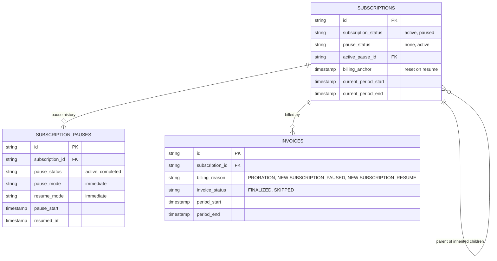
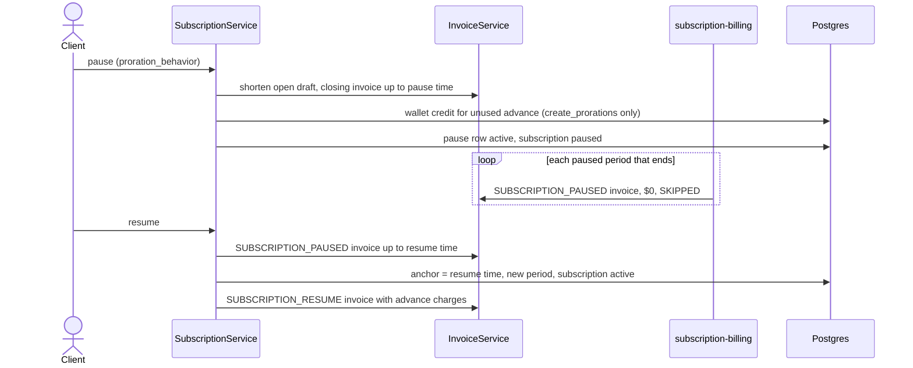

# Pause Subscription Billing, Design ERD

Status: **Proposed**
Date: 2026-10-14
Author: tsage
Ticket: FLE-1555

---

## 1. Problem statement

Customers cannot pause a subscription. Support for pausing was removed from the API some time back, so the
only option for a customer who wants to stop being billed for a while is to cancel and create a new
subscription later.

We want to bring back pause and resume. A paused subscription is billed for everything used up to the
pause, is not billed while paused, and starts billing again from the moment it is resumed.

## 2. How it works today

Pause is not supported. There is no pause or resume endpoint. Some pause code is still in the codebase (the
`subscription_pause` table, the `paused` status, and old pause and resume service methods), but none of it
is reachable and its behavior is wrong. It is removed as part of this work, except for the table, the
status values and the webhooks, which the new flow reuses.

Two existing flows are the closest references:

- **Immediate cancel with an invoice** already closes a period early. It cuts the current period at the
cancel time and bills usage and arrear fixed charges up to that point on a finalized invoice. Its request
takes a `proration_behavior`, and under `create_prorations` the unused part of advance fixed charges is
credited to the customer's wallet.
- **Trial end** already restarts billing from a given moment. It resets the billing anchor to the trial
end, starts a fresh full period and invoices its advance charges.


## 3. Proposed solution (MVP)

Two endpoints, `POST /subscriptions/{id}/pause` and `POST /subscriptions/{id}/resume`. Both act immediately.
Scheduled pause, scheduled resume and automatic resume are phase 2. The MVP is about closing the period
with the right proration, skipping the paused periods, and restarting billing on the right anchor.

**API contracts**

`POST /v1/subscriptions/{id}/pause`

```json
{
  "proration_behavior": "create_prorations",
  "reason": "Customer requested a hold",
  "metadata": { "requested_by": "support" }
}
```

| Field | Type | Required | Notes |
|---|---|---|---|
| `proration_behavior` | enum | no | `none` (default) or `create_prorations`. Applies to the closing invoice only |
| `reason` | string | no | Max 255 characters |
| `metadata` | map | no | Stored on the pause |

`POST /v1/subscriptions/{id}/resume`

```json
{
  "metadata": { "requested_by": "support" }
}
```

| Field | Type | Required | Notes |
|---|---|---|---|
| `metadata` | map | no | Stored on the pause |

Both endpoints return the subscription and its pause (id, `pause_status`, `pause_start`, `resumed_at`). A
failed validation returns `400`, an unknown subscription `404`.

**Pause**

The pause time is the moment of the request.

1. The current period's open draft invoice is shortened to end at the pause time, so the usage it holds is
not billed again at the original period end.
2. A closing invoice is raised for the current period start up to the pause time, the same way an immediate
cancel with an invoice raises it. It holds usage and arrear fixed charges for that window and no advance
charges, because those were billed when the period started. It is finalized and payable.
3. Proration on the closing invoice follows the request's `proration_behavior`:
   - `none`: arrear fixed charges are billed for the full period, and no credit is given for advance fixed
   charges.
   - `create_prorations`: arrear fixed charges are billed only for the used part of the period, and the
   unused part of advance fixed charges is credited to the customer's wallet.

   The request value drives both. This differs from cancel, where the arrear part still reads the
   subscription's own `proration_behavior`.
4. A pause row is created with `pause_status = active` and `pause_start` set to the pause time.
5. The subscription becomes `paused`. Its current period becomes the pause time up to the original period
end.

**While paused**

- The billing period keeps rolling on its anchor. The existing `subscription-billing` workflow does this.
Today it only picks `active` subscriptions, so it is extended to also pick `paused` ones, and for those it
only creates the paused invoice and advances the period.
- Every paused period gets an invoice with a new billing reason, `SUBSCRIPTION_PAUSED`. It has no line
items, is $0 and is always `SKIPPED`. It is never recomputed.
- Usage events keep arriving and are stored, but nothing bills them.

**Resume**

The resume time is the moment of the request.

1. The paused period in progress is closed at the resume time with a `SUBSCRIPTION_PAUSED` invoice, $0 and
`SKIPPED`.
2. The billing anchor is reset to the resume time. A fresh full period starts at the resume time.
3. An invoice with a new billing reason, `SUBSCRIPTION_RESUME`, bills the advance fixed charges of the new
period, the same way trial end bills them. It is finalized and payable. Arrear fixed charges and usage of
the new period are billed by the normal cycle invoice at its end.
4. The pause row becomes `completed` with `resumed_at` set to the resume time.
5. The subscription becomes `active`.

There is no proration at resume in the MVP.

**Business rules**

- BR1. Pausing a parent pauses its inherited children, and resuming the parent resumes them. Today a
paused inherited child is never picked up again on resume, so the cascade is fixed to include paused
children.
- BR2. Immediate cancel is allowed while paused. It bills nothing and completes the pause.
- BR3. Auto-cancellation for overdue invoices skips paused subscriptions.
- BR4. `subscription.paused` and `subscription.resumed` webhooks fire on each transition.

**Validations**

Pause is refused when:

- V1. The subscription is not `active` (draft, trialing, incomplete, paused or cancelled).
- V2. A cancellation is scheduled (`cancel_at` is set) or a plan change is pending.
- V3. The subscription is Stripe-managed, or is an individual inherited or grouped child.

Resume is refused when:

- V4. The subscription is not paused.
- V5. The subscription is calendar billed and the resume time is not on a period boundary (open question 1).

While paused:

- V6. A scheduled cancellation or a plan change is refused.

**Old code removal**

Only code that nothing outside the old pause flow calls is removed:

- The old pause and resume service methods and their unrouted API handler.
- The old pause and auto-resume blocks inside the legacy billing period function.

Anything shared with another billing flow stays, even if part of it looks unused. That covers the legacy
billing period function itself, the `subscription_pause` table, the pause status and mode values, and the
webhooks.


## 4. Use cases

1. **Pause.** A monthly subscription with an advance $310 fee and an arrear $62 fee, billed on the 1st, is
   paused on Jan 11. The closing invoice for Jan 1 to Jan 11 bills usage and the arrear fee. With
   `create_prorations` the arrear fee is $20 (10/31) and $210 (21/31 of $310) is credited to the wallet.
   With `none` the arrear fee is $62 and nothing is credited.
2. **Paused periods.** Jan 11 to Feb 1 and Feb 1 to Mar 1 each get a $0 `SKIPPED` invoice with reason
   `SUBSCRIPTION_PAUSED`.
3. **Resume.** The customer resumes on Mar 18. Mar 1 to Mar 18 gets a $0 `SKIPPED` invoice. The new period
   is Mar 18 to Apr 18, and the resume invoice bills the $310 advance fee.
4. **Cancel while paused.** The customer cancels on Feb 10 instead of resuming. Nothing is billed and the
   subscription is cancelled.


## 5. ERD and sequence


### 5.1 ERD

No schema change. The new billing reasons go into the existing `invoices.billing_reason` string column. The
tables below are shown only for the fields the pause flow uses.




### 5.2 Sequence




## 6. Phase 2

Each item adds to the MVP without changing how it behaves. The request fields below are new and optional,
so MVP callers are unaffected.

- **Scheduled pause.** `pause_mode` (`immediate` or `scheduled`) and `pause_start` on the pause request.
- **Automatic resume.** `pause_end` on the pause request.
- **Scheduled resume.** `resume_mode` (`immediate` or `scheduled`) and `resume_at` on the resume request.
- **Running scheduled pauses and resumes.** Extend the existing `subscription-billing` workflow with "pause
due" and "resume due" conditions, next to its existing `cancel_at` condition. Pause and resume use the
stored times as their effective times, so a late run produces the same invoices. A dedicated schedule is
the alternative, at the cost of extra Temporal runs on every tick.
- **Billing anchor on resume.** An explicit `billing_anchor` on the resume request, used instead of the
resume time.
- **Proration at resume.** Keep the original anchor and prorate the stub period after resume. The choice is
made on the pause request and stored on the pause row, so an automatic resume knows what to do, and a
manual resume can override it. This needs one new column on `subscription_pauses`.
- **Mid-period resume for calendar billing,** using the same stub proration.
- **Pausing an individual child** while the parent and the other children keep billing.
- **Pausing with a pending cancellation or plan change.**
- **Stripe-managed subscriptions,** through Stripe's `pause_collection`, with our Stripe sync no longer
overwriting the paused status.
- **Auto-cancellation of paused subscriptions** with an unpaid closing invoice.
- **Credit grants and coupons.** Re-anchor recurring credit grants on resume and extend repeating coupon end
dates by the pause length.
- **Commitments.** Prorate the commitment true-up on the closing invoice.
- **Pause at period end.** A `period_end` pause mode that skips the next period's advance charges on the
last cycle invoice.
- **Dry run.** Preview the closing and resume invoices before pausing or resuming.


## 7. Open questions

### 1. Calendar billing on resume

Re-anchoring at a mid-month resume breaks calendar alignment, and keeping the alignment needs a prorated
stub period, which is not in the MVP. Since the MVP only has immediate resume, refusing a mid-period resume
means a calendar-billed subscription can only be resumed on a period boundary day.

- **Proposed:** refuse a resume that is not on a period boundary for calendar-billed subscriptions.
- **Alternative:** switch the subscription to anniversary billing on resume, anchored at the resume time.

### 2. Auto-cancellation of paused subscriptions

A customer who pauses and never pays the closing invoice stays paused forever.

- **Proposed:** auto-cancellation skips paused subscriptions in the MVP.
- **Alternative:** include paused subscriptions with an overdue invoice in auto-cancellation. Cancelling a
paused subscription bills nothing, so this is safe.

### 3. Grouped children of a paused parent

Their charges are on the parent's invoice, so they are not billed while the parent is paused.

- **Proposed:** leave their status unchanged.
- **Alternative:** cascade the pause and resume to grouped children too, so their status shows `paused`.

### 4. Commitment true-up on the closing invoice

A commitment charges the gap between usage and an agreed minimum spend. The closing invoice is computed the
way cancel computes it, so it bills the full gap even for a cut-short period. Annual commitments billed
monthly also keep counting paused months.

- **Proposed:** keep the cancel behavior in the MVP. A pause does not waive the commitment.
- **Alternative 1:** skip the true-up on the closing invoice.
- **Alternative 2:** prorate the true-up to the used part of the period.

### 5. Stripe-managed subscriptions

Stripe owns their status and overwrites ours on its next webhook.

- **Proposed:** refuse the pause in the MVP.
- **Alternative:** pause in Stripe too through `pause_collection`, and stop our Stripe sync from overwriting
the paused status.

### 6. Entitlements while paused

The customer entitlements API only returns active and trialing subscriptions, so a paused customer has no
entitlements, boolean features included.

- **Proposed:** keep it. A paused subscription grants no access.
- **Alternative:** return the paused subscription's entitlements, so access continues while billing is
paused.

### 7. Credit grants and coupons while paused

Recurring credits that fall due during a pause are skipped and not caught up, and after resume they keep
their old delivery date. Repeating coupons have a calendar end date, so a pause uses up their time.

- **Proposed:** accept both in the MVP and fix them in phase 2.
- **Alternative:** on resume, re-anchor recurring grants to the new period and push coupon end dates out by
the pause length.
