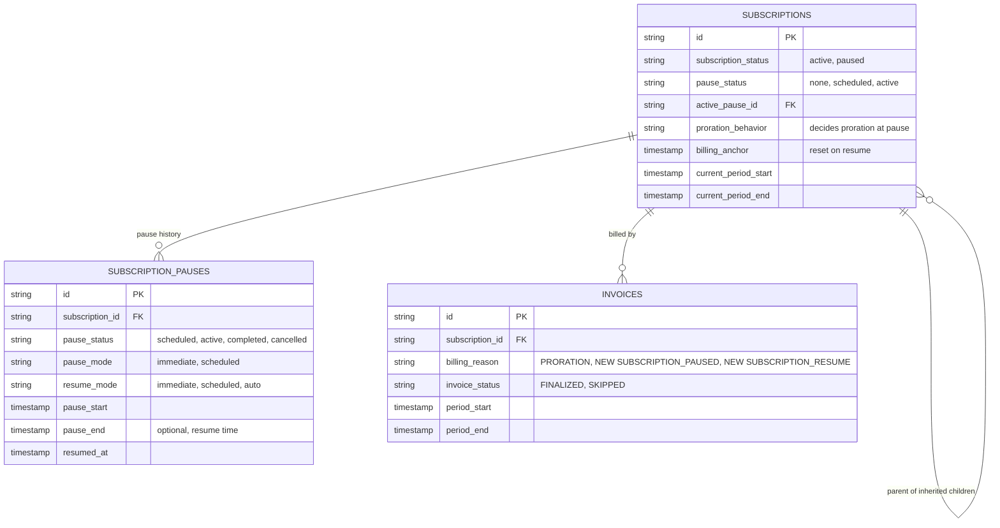
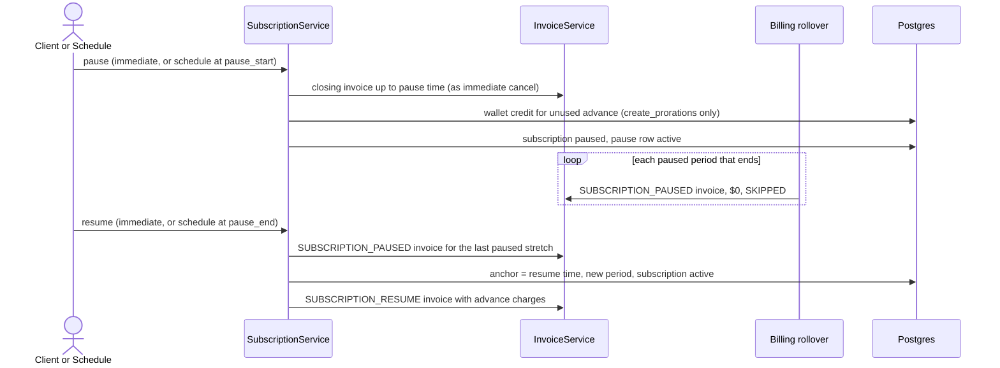

# Pause Subscription Billing, Design ERD

Status: **Proposed**
Date: 2026-10-14
Author: tsage
Ticket: FLE-1555

---

## 1. Problem statement

Customers cannot pause a subscription. Support for pausing was removed from the API some time back, so the
only option for a customer who wants to stop being billed for a while is to cancel and create a new
subscription later.

We want to bring back pause and resume. A paused subscription is billed for everything used up to the
pause, is not billed while paused, and starts billing again from the moment it is resumed.

## 2. How it works today

Pause is not supported. There is no pause or resume endpoint. Some pause code is still in the codebase (the
`subscription_pause` table, the `paused` status, and old pause and resume service methods), but none of it
is reachable and its behavior is wrong. It is removed as part of this work, except for the table, the
status values and the webhooks, which the new flow reuses.

Two existing flows are the closest references:

- **Immediate cancel with an invoice** already closes a period early. It cuts the current period at the
cancel time, bills usage and arrear fixed charges up to that point on a finalized invoice, and, when the
subscription's `proration_behavior` is `create_prorations`, credits the unused part of advance fixed
charges to the customer's wallet.
- **Trial end** already restarts billing from a given moment. It resets the billing anchor to the trial
end, starts a fresh full period and invoices its advance charges.


## 3. Proposed solution (MVP)

Two endpoints, `POST /subscriptions/{id}/pause` and `POST /subscriptions/{id}/resume`, and an extension of
the existing `subscription-billing` workflow that runs scheduled pauses and resumes.

**API contracts**

`POST /v1/subscriptions/{id}/pause`

```json
{
  "pause_mode": "scheduled",
  "pause_start": "2026-11-01T00:00:00Z",
  "pause_end": "2027-01-01T00:00:00Z",
  "reason": "Customer requested a hold",
  "metadata": { "requested_by": "support" }
}
```

| Field | Type | Required | Notes |
|---|---|---|---|
| `pause_mode` | enum | yes | `immediate` or `scheduled` |
| `pause_start` | timestamp | only for `scheduled` | Not accepted for `immediate`, which pauses now |
| `pause_end` | timestamp | no | When set, the subscription resumes automatically at this time |
| `reason` | string | no | Max 255 characters |
| `metadata` | map | no | Stored on the pause |

There is no proration field. Proration at pause follows the subscription's own `proration_behavior`.

`POST /v1/subscriptions/{id}/resume`

```json
{
  "resume_mode": "scheduled",
  "resume_at": "2026-12-15T00:00:00Z",
  "metadata": { "requested_by": "support" }
}
```

| Field | Type | Required | Notes |
|---|---|---|---|
| `resume_mode` | enum | yes | `immediate` or `scheduled` |
| `resume_at` | timestamp | only for `scheduled` | Not accepted for `immediate`, which resumes now. Written to the pause's `pause_end` |
| `metadata` | map | no | Stored on the pause |

Both endpoints return the subscription and its pause (id, `pause_status`, `pause_mode`, `resume_mode`,
`pause_start`, `pause_end`, `resumed_at`). A failed validation returns `400`, an unknown subscription `404`.

**Pause**

- At the pause time, the current period is closed the same way an immediate cancel with an invoice closes
it. Usage and arrear fixed charges up to the pause are billed on a closing invoice, which is finalized and
payable. Under `create_prorations`, the unused part of advance fixed charges is credited to the wallet.
- The subscription becomes `paused`. A scheduled pause stays `active` until `pause_start`, then the
schedule runs the same pause.
- If a scheduled pause starts exactly at a period end, the normal cycle invoice is raised first, including
the next period's advance charges, and the pause then credits them back under `create_prorations`.

**While paused**

- The billing period keeps rolling on its anchor. The existing `subscription-billing` workflow does this.
Today it only picks `active` subscriptions, so it is extended to also pick `paused` ones, and for those it
only creates the paused invoice and advances the period.
- Every paused period gets an invoice with a new billing reason, `SUBSCRIPTION_PAUSED`. It has no line
items, is $0 and is always `SKIPPED`. It is never recomputed.
- Usage events keep arriving and are stored, but nothing bills them.

**Resume**

- At the resume time, the last paused period is closed with a `SUBSCRIPTION_PAUSED` invoice, the billing
anchor is reset to the resume time and a fresh full period starts. Its advance charges are billed on an
invoice with a new billing reason, `SUBSCRIPTION_RESUME`, the same way trial end bills them.
- There is no proration at resume in the MVP.
- Resume on a pause that has not started yet cancels that pause.

**Schedule**

No new schedule. The existing `subscription-billing` schedule (every 2 minutes) already picks subscriptions
whose period has ended or whose `cancel_at` has passed. Two more conditions are added to that selection:

- a scheduled pause whose `pause_start` has passed, which starts the pause,
- a paused subscription whose `pause_end` has passed, which resumes it.

The per-subscription billing workflow checks pause first, then billing, so a pause, a resume and a period
rollover on the same subscription always run in one place and in order. Pause and resume use the stored
`pause_start` and `pause_end` as their effective times, not the time the job runs, so a late run produces
the same invoices. They call the same pause and resume code as the endpoints, so a schedule run and a
manual call never do the work twice. A dedicated schedule is the alternative in open question 1.

**Business rules**

- BR1. Pausing a parent pauses its inherited children, and resuming the parent resumes them. Today a
paused inherited child is never picked up again on resume, so the cascade is fixed to include paused
children.
- BR2. Immediate cancel is allowed while paused or while a pause is pending. It bills nothing and cancels
the pause.
- BR3. Auto-cancellation for overdue invoices skips paused subscriptions.
- BR4. `subscription.paused` and `subscription.resumed` webhooks fire on each transition.

**Validations**

Pause is refused when:

- V1. The subscription is not `active` (draft, trialing, incomplete, paused or cancelled).
- V2. A cancellation is scheduled (`cancel_at` is set) or a plan change is pending.
- V3. The subscription is Stripe-managed, or is an individual inherited or grouped child.
- V4. `pause_start` is missing or not in the future for `scheduled`, or is sent for `immediate`.
- V5. `pause_end` is not after the pause start, or is after the subscription's `end_date`.

Resume is refused when:

- V6. The subscription has no active or scheduled pause.
- V7. `resume_at` is missing or not in the future for `scheduled`, or is sent for `immediate`.
- V8. The subscription is calendar billed and the resume time is not on a period boundary (open question 2).

While paused or while a pause is pending:

- V9. A scheduled cancellation or a plan change is refused.

**Old code removal**

Only code that nothing outside the old pause flow calls is removed:

- The old pause and resume service methods and their unrouted API handler.
- The old pause and auto-resume blocks inside the legacy billing period function.

Anything shared with another billing flow stays, even if part of it looks unused. That covers the legacy
billing period function itself, the `subscription_pause` table, the pause status and mode values, and the
webhooks.


## 4. Use cases

1. **Immediate pause with an end date.** A monthly subscription with an advance $310 fee and an arrear $62
  fee, billed on the 1st, is paused on Jan 11 until Mar 18. The closing invoice for Jan 1 to Jan 11 bills
   usage and the arrear fee, either $20 (10/31) under `create_prorations` or $62 under `none`. Under
   `create_prorations`, $210 (21/31 of $310) is credited to the wallet.
2. **Paused periods.** Jan 11 to Feb 1, Feb 1 to Mar 1, and Mar 1 to Mar 18 each get a $0 `SKIPPED`
  invoice with reason `SUBSCRIPTION_PAUSED`.
3. **Automatic resume.** On Mar 18 the schedule resumes the subscription. The new period is Mar 18 to
  Apr 18, and the resume invoice bills the $310 advance fee.
4. **Scheduled pause.** Billing stays normal until `pause_start`, then use case 1 applies from that moment.
5. **Pause without an end date.** The subscription stays paused, rolling `SKIPPED` invoices, until someone
  calls resume.


## 5. ERD and sequence


### 5.1 ERD

No schema change. The new billing reasons go into the existing `invoices.billing_reason` string column. The
tables below are shown only for the fields the pause flow uses.




### 5.2 Sequence




## 6. Phase 2

Each item adds to the MVP without changing how it behaves.

- **Proration at resume.** Keep the original anchor and prorate the stub period after resume. The choice is
made on the pause request and stored on the pause row, so an automatic resume from the schedule knows
what to do. This needs one new column on `subscription_pauses`.
- **Mid-period resume for calendar billing,** using the same stub proration.
- **Pausing an individual child** while the parent and the other children keep billing.
- **Pausing with a pending cancellation or plan change.**
- **Stripe-managed subscriptions,** through Stripe's `pause_collection`, with our Stripe sync no longer
overwriting the paused status.
- **Auto-cancellation of paused subscriptions** with an unpaid closing invoice.
- **Credit grants and coupons.** Re-anchor recurring credit grants on resume and extend repeating coupon end
dates by the pause length.
- **Commitments.** Prorate the commitment true-up on the closing invoice.
- **Pause at period end.** A `period_end` pause mode that skips the next period's advance charges on the
last cycle invoice instead of crediting them back.
- **Dry run.** Preview the closing and resume invoices before pausing or resuming.


## 7. Open questions

### 1. Which job starts and ends pauses?

Scheduled pauses and `pause_end` need something that runs on a timer. The paused-period rollover already
has to live in `subscription-billing`, and every scheduled run costs Temporal actions even when nothing is
due.

- **Proposed:** extend the existing `subscription-billing` schedule (every 2 minutes) with the "pause due"
and "resume due" conditions, next to the existing `cancel_at` condition. No extra schedule runs, and pause,
resume and rollover for one subscription happen in one workflow, in order. The selection query joins the
active pause row to read `pause_start` and `pause_end`.
- **Alternative:** a dedicated `subscription-pause-transitions` schedule, built like
`subscription-trial-end-due`. It keeps the billing workflow unchanged, but adds a schedule run, workflow
start and activities on every tick (96 a day at 15 minutes), and two schedules can act on the same
subscription at the same time.

### 2. Calendar billing on resume

Re-anchoring at a mid-month resume breaks calendar alignment, and keeping the alignment needs a prorated
stub period, which is not in the MVP.

- **Proposed:** refuse a resume that is not on a period boundary for calendar-billed subscriptions.
Scheduled resume and `pause_end` must fall on a boundary.
- **Alternative:** switch the subscription to anniversary billing on resume, anchored at the resume time.

### 3. Auto-cancellation of paused subscriptions

A customer who pauses and never pays the closing invoice stays paused forever.

- **Proposed:** auto-cancellation skips paused subscriptions in the MVP.
- **Alternative:** include paused subscriptions with an overdue invoice in auto-cancellation. Cancelling a
paused subscription bills nothing, so this is safe.

### 4. Grouped children of a paused parent

Their charges are on the parent's invoice, so they are not billed while the parent is paused.

- **Proposed:** leave their status unchanged.
- **Alternative:** cascade the pause and resume to grouped children too, so their status shows `paused`.

### 5. Commitment true-up on the closing invoice

A commitment charges the gap between usage and an agreed minimum spend. The closing invoice is computed the
way cancel computes it, so it bills the full gap even for a cut-short period. Annual commitments billed
monthly also keep counting paused months.

- **Proposed:** keep the cancel behavior in the MVP. A pause does not waive the commitment.
- **Alternative 1:** skip the true-up on the closing invoice.
- **Alternative 2:** prorate the true-up to the used part of the period.

### 6. Stripe-managed subscriptions

Stripe owns their status and overwrites ours on its next webhook.

- **Proposed:** refuse the pause in the MVP.
- **Alternative:** pause in Stripe too through `pause_collection`, and stop our Stripe sync from overwriting
the paused status.

### 7. Entitlements while paused

The customer entitlements API only returns active and trialing subscriptions, so a paused customer has no
entitlements, boolean features included.

- **Proposed:** keep it. A paused subscription grants no access.
- **Alternative:** return the paused subscription's entitlements, so access continues while billing is
paused.

### 8. Credit grants and coupons while paused

Recurring credits that fall due during a pause are skipped and not caught up, and after resume they keep
their old delivery date. Repeating coupons have a calendar end date, so a pause uses up their time.

- **Proposed:** accept both in the MVP and fix them in phase 2.
- **Alternative:** on resume, re-anchor recurring grants to the new period and push coupon end dates out by
the pause length.

